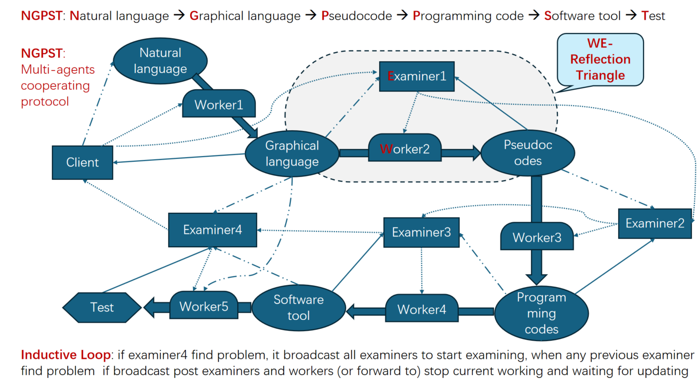
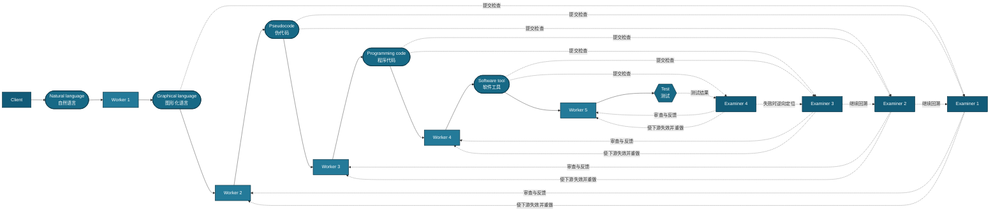

# Code Agents：NGPST 多智能体协作与反思流程

> 将自然语言需求逐步转换为可测试的软件，并在每个转换阶段引入独立审查、反馈修正和故障回溯。

## 原始流程图



## 一、流程图在表达什么

这张图描述了一种面向软件开发的 **多智能体流水线**。它不是让一个 Agent 从需求直接生成最终代码，而是把工作拆成一组可检查的中间产物：

```text
自然语言 → 图形化语言 → 伪代码 → 程序代码 → 软件工具 → 测试
```

原图把这条链路称为 **NGPST**。图中实际展示了两个以 `P` 开头的阶段（Pseudocode 和 Programming code），因此本文沿用原图名称，不另行改写其缩写。

流程中的 Agent 分为两类：

- **Worker（执行者）**：负责把当前阶段的产物转换成下一阶段产物。
- **Examiner（审查者）**：检查相邻阶段之间的语义一致性和产物质量；发现问题后提供反馈，并触发局部重做或跨阶段回溯。

`Client` 代表用户或上层调用方，负责提出自然语言目标、补充约束并接收执行结果。

## 二、简化重绘

下面的 Mermaid 图保留了原图的主要逻辑。GitHub 可以直接渲染该图，也便于后续修改。



> 注意：原图没有给实线、点线和点划线提供完整图例，部分箭头也存在交叉。上图是对核心语义的结构化重绘，并非逐根箭头的机械复刻。

## 三、阶段与职责

| 阶段 | Worker 的任务 | 主要产物 | Examiner 的关注点 |
| --- | --- | --- | --- |
| 需求理解 | Worker 1 将自然语言结构化 | 图、状态机、数据流或模块关系 | 是否遗漏目标、约束和参与者 |
| 方案设计 | Worker 2 将图形语义细化 | 伪代码、接口与控制流程 | 伪代码是否忠实表达设计 |
| 代码生成 | Worker 3 实现伪代码 | 可执行程序代码 | 实现是否偏离算法与接口约定 |
| 工具构建 | Worker 4 组装运行环境 | 可运行的软件或工具 | 构建、依赖和运行行为是否正确 |
| 验证交付 | Worker 5 执行验证 | 测试结果与缺陷报告 | 结果是否满足原始需求与验收条件 |

这类拆分的关键价值是：**每一步都有明确输入、输出和验收边界**。当最终测试失败时，系统不必笼统地要求“重新写代码”，而可以判断问题来自需求理解、设计、伪代码、实现、构建还是测试本身。

## 四、核心机制分析

### 1. 渐进式语义收敛

自然语言通常包含歧义，直接生成代码会把歧义隐式固化到实现中。NGPST 先把需求转换成图形化结构，再转换成伪代码和程序代码，相当于逐级降低表达自由度：

- 自然语言适合描述目标和业务意图；
- 图形化语言适合暴露模块、依赖和数据流；
- 伪代码适合确认算法和控制逻辑；
- 程序代码负责精确实现；
- 软件工具和测试负责验证可运行性与目标达成情况。

每个中间产物都是一个“语义检查点”，可以在缺陷进入更昂贵的下游阶段之前将其拦截。

### 2. Worker–Examiner 反思三角

原图特别标出了 **WE-Reflection Triangle**。它可以理解为一个局部反思闭环：

1. 上一阶段产物提供约束；
2. Worker 生成下一阶段产物；
3. Examiner 对比转换前后的产物；
4. Examiner 把问题反馈给 Worker，Worker 据此修订；
5. 审查通过后，产物才被后续阶段使用。

这里的“反思”不是让生成者简单自评，而是通过角色分离引入第二视角。为了让这种分离真正有效，Examiner 应拥有独立的检查清单和判定标准，不应只重复 Worker 的推理过程。

### 3. Inductive Loop：逆向定位与前向失效

原图底部的说明表达了一种归纳式回溯机制：如果靠后的 Examiner（例如 Examiner 4）发现问题，就通知其他 Examiner 从后向前检查；一旦前序 Examiner 找到更早的根因，则通知受影响的后续 Examiner 和 Worker 暂停当前工作，等待上游产物更新。

可将这个过程拆成两条链：

```text
逆向诊断：测试失败 → 工具检查 → 代码检查 → 伪代码检查 → 需求/图形检查
前向失效：根因修复 → 标记下游产物过期 → 取消旧任务 → 按依赖顺序重新生成与审查
```

这比“所有 Agent 同时重做”更有效，因为系统只重跑受根因影响的阶段；同时也比“只改最后一层”更可靠，因为它允许定位上游的语义错误。

### 4. Client 与协作协议

Client 不只是输入框。当 Examiner 发现需求本身存在冲突、缺少关键条件或没有唯一解释时，流程应回到 Client 请求澄清。多 Agent 协作协议至少需要传递以下信息：

- 当前使用的上游产物及其版本；
- Worker 的输出和关键假设；
- Examiner 的结论、证据和修改建议；
- 哪些下游任务需要暂停或作废；
- 当前迭代次数、失败原因和是否需要人工决策。

## 五、可实现的工程方案

### 1. 统一产物协议

每个阶段都输出结构化记录，而不是只输出一段聊天文本：

```json
{
  "stage": "pseudocode",
  "version": 3,
  "based_on": ["graphical-language@2"],
  "assumptions": ["用户登录状态由上游系统提供"],
  "artifact": "...",
  "status": "pending_review"
}
```

版本和依赖关系使系统能够准确判断：上游产物更新后，哪些下游结果已经过期。

### 2. Examiner 使用固定结果类型

审查结果建议限制为三类：

- `PASS`：产物通过，可以进入下一阶段；
- `REVISE`：当前 Worker 根据反馈在本阶段内修改；
- `ROLLBACK`：问题来自更早阶段，需要触发跨阶段回溯。

审查报告必须包含证据、受影响需求和建议回退位置，避免只有“结果不好”之类不可执行的评价。

### 3. 协调器维护状态机

```text
PENDING → RUNNING → REVIEWING → PASSED
                   ↘ REVISING ──┘
                   ↘ ROLLED_BACK
```

协调器负责调度 Worker 和 Examiner、提交版本、取消过期任务以及向 Client 汇报。Agent 本身只处理当前阶段，避免每个 Agent 都持有一套不一致的全局状态。

### 4. 主流程伪代码

```text
artifacts = [natural_language]

for stage in pipeline:
    repeat:
        candidate = stage.worker.run(artifacts.latest)
        review = stage.examiner.check(
            source=artifacts.latest,
            candidate=candidate,
            acceptance_criteria=stage.criteria
        )

        if review == PASS:
            artifacts.commit(candidate)
            break

        if review == REVISE:
            stage.worker.apply_feedback(review.feedback)
            continue

        if review == ROLLBACK:
            root_stage = trace_back_to_first_invalid_artifact(review)
            invalidate_all_downstream_artifacts(root_stage)
            restart_from(root_stage)

    if retry_limit_exceeded:
        ask_client_for_decision()
```

## 六、落地时需要补充的约束

原图给出了协作思想，但要成为稳定系统，还需要明确以下规则：

1. **验收标准**：每个 Examiner 根据什么判断通过，必须可复核。
2. **停止条件**：设置最大修订次数、最大回溯深度和人工接管条件，避免 Agent 无限互评。
3. **并发边界**：只有依赖版本确定的任务才能并行；上游未通过时，不应让大量下游任务继续消耗资源。
4. **上下文隔离**：Worker 和 Examiner 可以共享产物，但最好使用不同提示词、检查表或模型配置，降低同源偏差。
5. **可观测性**：保存每次生成、审查、回退和作废事件，才能解释最终结果是如何产生的。
6. **安全边界**：程序执行、外部工具调用和部署动作需要沙箱、权限控制与人工审批。

## 七、总结

这张图的核心不是“使用更多 Agent”，而是把软件开发组织成一个 **可检查、可回退、可追踪的产物流水线**：

- Worker 负责阶段转换；
- Examiner 负责独立验证；
- Reflection Triangle 负责局部修正；
- Inductive Loop 负责跨阶段根因定位；
- 版本化依赖负责让受影响的下游工作失效并重建；
- Client 在需求不完备或系统无法收敛时提供最终决策。

如果实现得当，这一模式可以减少“错误需求一路传到最终代码”的概率，并让 Code Agents 的失败位置、修复范围和演化过程更加透明。

## 图片说明

本文分析基于仓库内的原始流程图。原图中的术语、拼写和编号均按图片保留；Mermaid 图是为阅读和维护而做的语义重绘。
